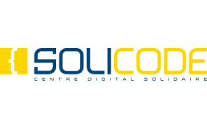
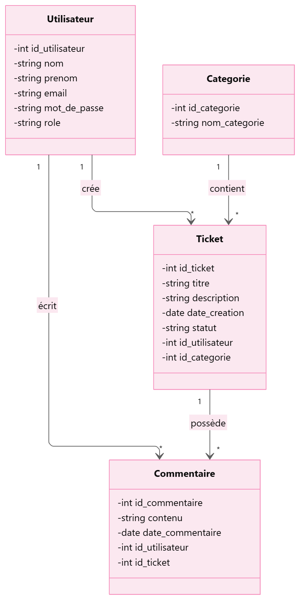

<!-- _class: lead -->
<!-- _paginate: false -->

  
  

# Rapport de projet

# FILE ROUGE

## Système Helpdesk — Gestion des tickets

**Réalisé par :** Tasnime Sahli

**Encadrant :** ES-SARRAJ Fouad

Centre SoliCode Tanger • OFPPT • 2026

---

<!-- _class: divider -->

## Remerciements

---
<!-- _class: agenda -->
## Planification:

1. Plan de la présentation
2. Introduction et contexte du projet
3. Méthodologies et planification
4. Branche fonctionnelle
5. Compréhension du besoin : empathie, problématique et idéation
6. Conception : diagrammes de cas d'utilisation et de classes
7. Stack technologique et structure technique
8. Conclusion

---

## Introduction

Présentation générale du projet File Rouge et de son objectif.

---

## Contexte du projet

Développement d'une application Helpdesk pour faciliter la déclaration et le suivi des problèmes en ligne.

---

<!-- _class: divider -->

# Les Methode de Travail:

---

<!-- _class: image-only landscape-image -->

## Scrum

---

<!-- _class: image-only landscape-image -->

## Processus 2TUP

---

<!-- _class: image-only landscape-image -->

## Design Thinking

---
<!-- _class: sprints -->

## Planification

Le projet est organisé en plusieurs sprints:

**Sprint 01 — Gestion des produits**
- CRUD Product.
- Affichage des produits dans la plateforme.
- Diagramme de cas d'utilisation.

**Sprint 02 — Gestion des catégories**
- CRUD Category.
- Organisation des fichiers.
- Séparation des responsabilités.

**Sprint 03 — Architecture**
- Utilisation du pattern DAO.
- Architecture en 3 couches.
- Séparation de la logique métier et des données.
  
------

## Branche fonctionnelle

- **Client :** déclarer un problème et suivre son ticket.
- **Support :** consulter et traiter les tickets.
- **Admin :** gérer les utilisateurs et les catégories.

---

## Carte d'empathie

**Utilisateur : Client**

- **Besoin :** signaler un problème facilement.
- **Difficulté :** suivre sa demande.
- **Attente :** recevoir une réponse et connaître l'état du ticket.

---

## Définition du problème

Le client rencontre un problème et ne dispose pas toujours d'une plateforme simple pour le signaler en ligne et suivre son traitement.

---

## Idéation

Créer une plateforme Helpdesk qui permet de :

- Déclarer un problème en ligne.
- Créer un ticket.
- Suivre son état.
- Communiquer avec le support.

---

<!-- _class: image-only portrait-image -->

## Diagramme de class

---
<!-- _class: image-only portrait-image -->
## Diagramme de cas d'utilisateur

---
## Stack technologique

- **Backend actuel :** PHP Native
- **Backend prévu :** Laravel
- **Frontend :** HTML · CSS · Tailwind CSS
- **Interactivité :** JavaScript · Alpine.js
- **Base de données :** MySQL · PDO
- **Diagrammes :** MCD · Diagramme de classes

---

<!-- _class: architecture -->

## Architecture

**Présentation → Logique métier → Accès aux données**

Navigateur · HTML / CSS / JavaScript

↓

Controllers

↓

Services

↓

DAO · PDO

↓

MySQL

---

<!-- _class: conclusion -->

## Conclusion

- Application Helpdesk pour la gestion des tickets.
- Déclaration des problèmes en ligne.
- Suivi des demandes.
- Base pour une évolution vers Laravel.

---

<!-- _class: lead closing -->
<!-- _paginate: false -->

# Merci pour votre attention !